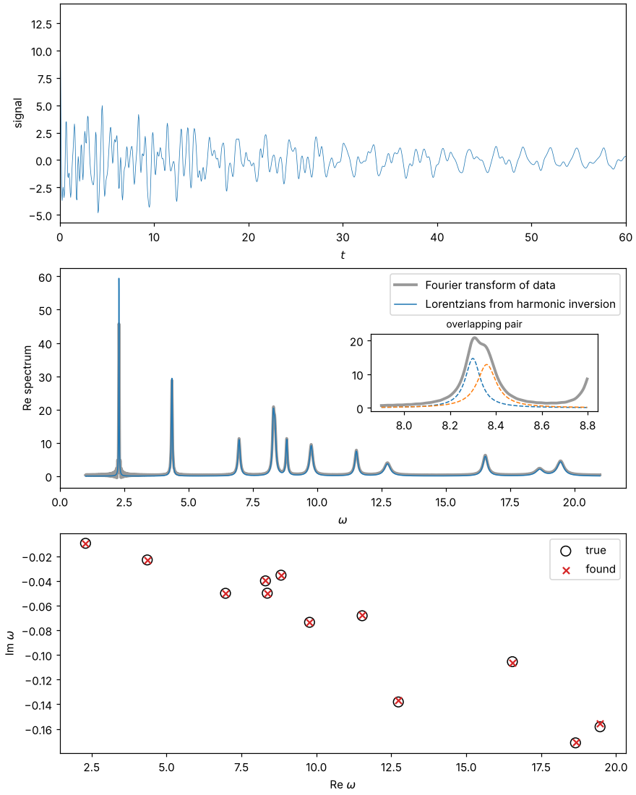

# pyharminv

[](https://github.com/aeberspaecher/pyharminv/actions/workflows/tests.yml)
[](https://aeberspaecher.github.io/pyharminv/)
[](https://github.com/aeberspaecher/pyharminv/blob/main/pyproject.toml)
[](https://github.com/aeberspaecher/pyharminv/blob/main/LICENSE)

**Harmonic inversion of signals in Python.** pyharminv decomposes a sampled
signal into damped complex exponentials

    c(t) = Σ_k d_k exp(-i ω_k t),    ω_k = Ω_k − i Γ_k / 2,

and thereby fits Lorentzian lines (centre Ω_k, full width Γ_k) to its
spectrum. Unlike a Fourier transform, harmonic inversion is not limited by
the Fourier resolution `2π/T`: it resolves overlapping lines and finds
widths and amplitudes from short signals.

📖 **Documentation:** <https://aeberspaecher.github.io/pyharminv/>



## Features

* **Harmonic inversion** (`harminv`) with two solvers:
  * *Filter diagonalization* (default, Mandelshtam & Taylor 1997) splits the
    frequency range into windows, each solved from the whole signal. It
    scales to long signals with hundreds of lines and is robust to noise.
  * *Padé approximants* (Wiersig & Main 2008) fit the whole band at once,
    for signals of up to a few hundred samples, either by least squares
    (matrix pencil, Hua & Sarkar 1990) or with the classical robust SVD
    algorithm of Gonnet, Güttel & Trefethen (2013).
* **Results you can use directly:** Lorentzian parameters, Q factors, error
  estimates for every mode, mode selection, reconstruction, the fitted
  spectrum and its zeros (anti-resonances).
* **Refinement** by nonlinear least squares, which reaches the Cramér-Rao
  bound and gives error bars.
* **Robust Padé approximation** (`padeapprox`) as a general tool, translated
  from Chebfun.
* **Preprocessing:** detrending and linear-phase FIR low-, high- and
  band-pass filters that leave no transients and whose effect on the
  amplitudes is undone exactly.
* **Stochastic subspace identification** (SSI-Cov and SSI-Data) for systems
  driven by unmeasured broadband noise (operational modal analysis), with
  stabilization diagrams, mode shapes, damping ratios and the MAC.

## Installation

pyharminv is not on PyPI yet. Install it from GitHub:

```bash
pip install git+https://github.com/aeberspaecher/pyharminv
```

or from a clone, with the optional extras for tests, docs and notebooks:

```bash
git clone https://github.com/aeberspaecher/pyharminv
cd pyharminv
pip install -e ".[test,docs,examples]"
```

Requires Python ≥ 3.10, NumPy ≥ 1.22 and SciPy ≥ 1.8.

## Quick start

```python
import numpy as np
from pyharminv import harminv

dt = 0.1
t = dt * np.arange(300)
x = (np.exp(-0.05 * t) * np.cos(3.0 * t)
     + 0.8 * np.exp(-0.02 * t) * np.cos(7.0 * t + 1.2))

result = harminv(x, dt)
print(result)
#   omega.real   omega.imag      Q   |d|    arg d   error
#            3        -0.05     30     1   0.0000   ...
#            7        -0.02    175   0.8  -1.2000   ...

result.center, result.width, result.Q        # Ω_k, Γ_k, Ω_k/Γ_k
result.lorentzians()                         # centre, FWHM, height, area
result.reconstruct(t)                        # fitted signal
result.spectrum(np.linspace(0, 10, 1000))    # fitted complex spectrum
result.zeros()                               # its zeros (anti-resonances)
```

For a real signal only modes with `Re ω ≥ 0` are returned, and
`x(t) = Re Σ_k d_k exp(-i ω_k t)`.

### Noisy data

Set `tol` to the relative noise level (noise standard deviation divided by
the rms of the signal), drop spurious weak modes, and refine the rest:

```python
result = harminv(x, dt, tol=1e-3)
lines = result.select(min_magnitude=0.05, max_rel_error=1e-3)
fit = lines.refine(x, dt)
fit.omega, fit.info["omega_std"]   # maximum-likelihood estimate, 1σ errors
```

Long signals need no special treatment: `harminv` chooses frequency windows
automatically (100 000 samples with 200 lines take about 5 s). Restrict the
search with `omega_min`/`omega_max` if only a band is of interest.

### Trends and filters

```python
from pyharminv import detrend, highpass

result = harminv(detrend(x), dt)          # remove a linear drift

hp = highpass(dt, omega_c=1.0)            # linear-phase FIR filter
y, t0 = hp.apply(x)                       # transient-free samples only
result = hp.correct(harminv(y, dt, t0=t0)).select(omega_min=1.25)
```

The filtered signal is exactly the same sum of damped exponentials with the
amplitudes multiplied by the filter response, which `correct` divides out.

### Noise-driven systems: stochastic subspace identification

If the system cannot decay freely but is driven by unknown broadband noise,
identify its modes from the measured response (one column per channel):

```python
from pyharminv import ssi_cov, ssi_data, ssi_stabilization

r = ssi_cov(y, dt, order=16, block_rows=40)       # covariance-driven SSI
modes = r.select(max_rel_error=0.01, max_damping=0.2)
modes.omega, modes.damping_ratio, modes.mode_shape

ssi_data(y, dt, order=16, block_rows=40)          # data-driven SSI
ssi_stabilization(y, dt, range(2, 61, 2)).plot()  # stabilization diagram
```

### Padé approximation

```python
from pyharminv import padeapprox

r = padeapprox(np.exp, 4, 4)     # from a function or its Taylor coefficients
r(0.5), r.poles, r.residues, r.zeros
```

## Documentation and notebooks

The [documentation](https://aeberspaecher.github.io/pyharminv/) covers
[usage](https://aeberspaecher.github.io/pyharminv/usage.html),
[theory and conventions](https://aeberspaecher.github.io/pyharminv/theory.html),
the [API](https://aeberspaecher.github.io/pyharminv/api.html) and renders
the executed notebooks from [`notebooks/`](https://github.com/aeberspaecher/pyharminv/tree/main/notebooks):

| Notebook | Topic |
| --- | --- |
| [01 Harmonic inversion basics](https://github.com/aeberspaecher/pyharminv/blob/main/notebooks/01_harmonic_inversion_basics.ipynb) | Damped cosines, Lorentzian lines versus the Fourier spectrum, lines closer than the Fourier resolution |
| [02 Noise and long signals](https://github.com/aeberspaecher/pyharminv/blob/main/notebooks/02_noise_and_long_signals.ipynb) | Choosing `tol`, spurious modes, 100 lines in 50 000 samples, Cramér-Rao bound and `refine`, FDM versus Padé |
| [03 Padé approximation](https://github.com/aeberspaecher/pyharminv/blob/main/notebooks/03_pade_approximation.ipynb) | Analytic continuation, branch cuts, divergent series, Froissart doublets |
| [04 Anti-resonances](https://github.com/aeberspaecher/pyharminv/blob/main/notebooks/04_anti_resonances.ipynb) | Zeros of a frequency response from the fitted modes |
| [05 Stochastic subspace identification](https://github.com/aeberspaecher/pyharminv/blob/main/notebooks/05_stochastic_subspace_identification.ipynb) | SSI-Cov step by step, stabilization diagram, mode shapes, SSI-Data |
| [06 Choosing an identification method](https://github.com/aeberspaecher/pyharminv/blob/main/notebooks/06_choosing_an_identification_method.ipynb) | `harminv` versus SSI-Cov versus SSI-Data, with a decision table |
| [07 SSI under extreme noise](https://github.com/aeberspaecher/pyharminv/blob/main/notebooks/07_ssi_extreme_noise.ipynb) | Identification with measurement noise up to 30 times the signal |

`examples/lorentz_fit.py` produces the figure above.

## Development

```bash
pip install -e ".[test,docs]"
pytest                                    # run the test suite
sphinx-build -W docs docs/_build/html     # build the documentation
```

The tests use synthetic signals with known frequencies, widths and
amplitudes (clean and noisy, real and complex, long signals with many
lines, overlapping lines). The documentation is built and published to
GitHub Pages by the `docs` workflow on every push to `main`.

To build a release:

```bash
pip install build twine
python -m build && twine check dist/*
```

The version is set in `src/pyharminv/__init__.py`; see
[`CHANGELOG.md`](https://github.com/aeberspaecher/pyharminv/blob/main/CHANGELOG.md). Bug reports and pull requests are welcome on
the [issue tracker](https://github.com/aeberspaecher/pyharminv/issues).

## References

1. J. Wiersig and J. Main, Phys. Rev. E **77**, 036205 (2008).
2. P. Gonnet, S. Güttel and L. N. Trefethen, SIAM Review **55**, 101 (2013).
3. Y. Hua and T. K. Sarkar, IEEE Trans. Acoust. Speech Signal Process.
   **38**, 814 (1990).
4. V. A. Mandelshtam and H. S. Taylor, J. Chem. Phys. **107**, 6756 (1997).
5. M. R. Wall and D. Neuhauser, J. Chem. Phys. **102**, 8011 (1995).
6. P. Van Overschee and B. De Moor, *Subspace Identification for Linear
   Systems*, Kluwer (1996).
7. B. Peeters and G. De Roeck, Mech. Syst. Signal Process. **13**, 855
   (1999).

## License

BSD 3-clause, see [`LICENSE`](https://github.com/aeberspaecher/pyharminv/blob/main/LICENSE). `src/pyharminv/pade.py` is a
translation of `padeapprox.m` from [Chebfun](https://www.chebfun.org)
(BSD 3-clause, see [`LICENSES/`](https://github.com/aeberspaecher/pyharminv/tree/main/LICENSES)). The earlier Python 2 code and
the reference material are kept in `legacy/` and `references/`.
