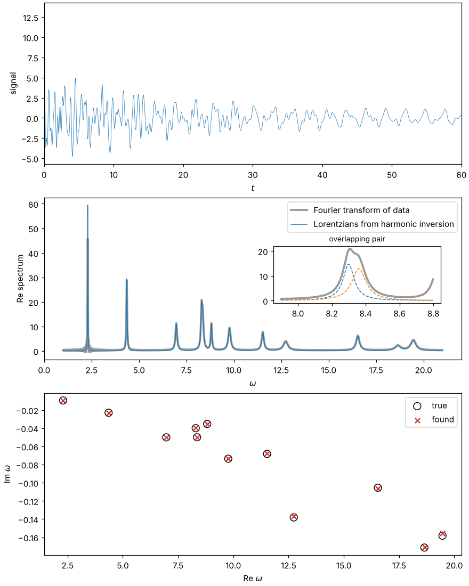

pyharminv
=========

Harmonic inversion of signals: decompose a sampled signal into damped
complex exponentials and fit Lorentzian lines to its spectrum, beyond the
resolution limit of the Fourier transform.

.. toctree::
   :maxdepth: 2

   usage
   theory
   api
