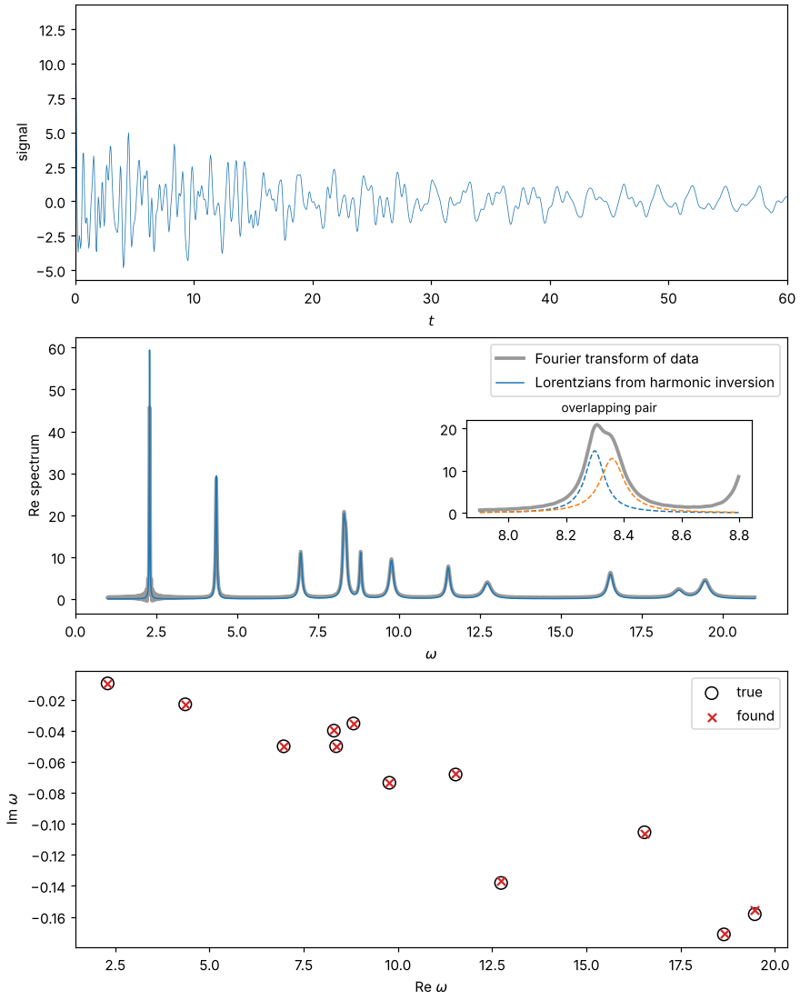

pyharminv
=========

Harmonic inversion of signals: decompose a sampled signal into damped
complex exponentials and fit Lorentzian lines to its spectrum, beyond the
resolution limit of the Fourier transform.

Features
--------

* **Harmonic inversion** with filter diagonalization (long signals, many
  lines) or Padé approximants (short signals), with error estimates and
  nonlinear least-squares refinement.
* **Robust Padé approximation** as a tool in its own right.
* **Preprocessing**: detrending and linear-phase FIR filters that leave no
  transients and whose effect on the amplitudes is undone exactly.
* **Stochastic subspace identification** (SSI-Cov, SSI-Data) for systems
  driven by unmeasured noise, with stabilization diagrams and mode shapes.

Install from GitHub:

.. code-block:: bash

   pip install git+https://github.com/aeberspaecher/pyharminv

.. toctree::
   :maxdepth: 2

   usage
   theory
   theory_ssi
   notebooks
   api
